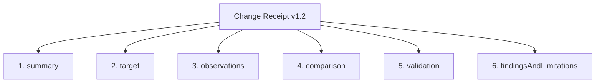

# SKYTRACE: Normalized Observation Contract & Change Receipt Specification
**Document Version:** 1.2  
**Document Status:** Integration Specification & Proposed Contract (Non-Implemented / Documentation Only)  
**System:** SKYTRACE — The Changing Infrared Sky, Made Explorable (NASA Space Apps Challenge 2026)  
**Backend Reference:** FastAPI Archive Service (`schema_version: 0.1`, DR1 / QR3 SIA2 Pipeline)  
**Frontend Reference:** React / TypeScript Viewer (`ChangeReceipt.tsx` v1.0 baseline)  
**Schema Definition:** `docs/schemas/change_receipt_v1.2.schema.json` (Draft 2020-12)  
**Reference Example:** `docs/examples/change_receipt_example_v1.2.json`  
**Date:** 14 November 2026  

---

## Important Notice on Document Scope & Authority

> **SPECIFICATION NOTICE:**  
> This document defines a **proposed integration contract (v1.2)** and architectural standard for the SKYTRACE project. It is **NOT** a claim of completed implementation.
> 
> * The **FastAPI backend** currently implements `schema_version: 0.1` endpoints (`POST /v1/searches`, `POST /v1/searches/{id}/cutouts`, `GET /v1/cutouts/{id}`) with fixed status values.
> * The **React frontend** currently implements a v1.0 data model (`NormalizedObservation`, `ChangeReceipt.tsx` v1.0) and uses hardcoded target presets.
> * The proposed v1.2 stage-specific schemas, six-section Change Receipt structure, and per-check validation evidence logs represent **target integration contracts** awaiting future frontend/backend implementation.
> * No application source code (`.py`, `.ts`, `.tsx`, `.js`) was modified as part of this specification task.

---

## Table of Contents

1. [Executive Summary & System Architecture](#1-executive-summary--system-architecture)
2. [Deliverable A: Stage-Specific Data Contracts](#2-deliverable-a-stage-specific-data-contracts)
   - [2.1 SearchResult Contract](#21-searchresult-contract)
   - [2.2 PreparedObservation Contract](#22-preparedobservation-contract)
   - [2.3 ChangeReceipt Conceptual Contract](#23-changereceipt-conceptual-contract)
   - [2.4 Backend-to-Frontend Field Mapping Matrix](#24-backend-to-frontend-field-mapping-matrix)
   - [2.5 Coordinate and Physical Unit Conversions](#25-coordinate-and-physical-unit-conversions)
   - [2.6 Six Mandatory Architectural Distinctions](#26-six-mandatory-architectural-distinctions)
   - [2.7 Missing Values and Processing-Version Provenance](#27-missing-values-and-processing-version-provenance)
3. [Deliverable B: Proposed Change Receipt Specification (v1.2)](#3-deliverable-b-proposed-change-receipt-specification-v12)
   - [3.1 Purpose & Exportable Provenance Model](#31-purpose--exportable-provenance-model)
   - [3.2 The Six Required Top-Level Sections](#32-the-six-required-top-level-sections)
   - [3.3 Comprehensive Field-by-Field Reference](#33-comprehensive-field-by-field-reference)
   - [3.4 Technical Readiness vs. Scientific Validation](#34-technical-readiness-vs-scientific-validation)
   - [3.5 Strict Prohibition on Visual Differences as Astronomical Discovery](#35-strict-prohibition-on-visual-differences-as-astronomical-discovery)
4. [Deliverable C: Scientific Validation Rules & Mission Constraints](#4-deliverable-c-scientific-validation-rules--mission-constraints)
   - [4.1 Status Vocabulary & Structured Evidence Model](#41-status-vocabulary--structured-evidence-model)
   - [4.2 Ten Validation Checks and Required Evidentiary Standards](#42-ten-validation-checks-and-required-evidentiary-standards)
   - [4.3 SPHEREx Mission Constraints & Current Baseline Limitations](#43-spherex-mission-constraints--current-baseline-limitations)
5. [Deliverable D: Real WISE 0855 DR1 Demonstration Sample](#5-deliverable-d-real-wise-0855-dr1-demonstration-sample)
   - [5.1 Dual-Epoch Observation Parameters](#51-dual-epoch-observation-parameters)
   - [5.2 Differential Spectral and Temporal Analysis](#52-differential-spectral-and-temporal-analysis)
   - [5.3 Provenance and Demonstration Sample Status](#53-provenance-and-demonstration-sample-status)
6. [Deliverable E: Integration Acceptance Checklist](#6-deliverable-e-integration-acceptance-checklist)
   - [6.1 Fifteen Integration Scenarios](#61-fifteen-integration-scenarios)
7. [Five SKYTRACE Presets Reference](#7-five-skytrace-presets-reference)
   - [7.1 Curated Preset Directory](#71-curated-preset-directory)
   - [7.2 Searchable Archive Footprint vs. Confirmed Detection](#72-searchable-archive-footprint-vs-confirmed-detection)
8. [JSON Schema Specification & Usage Guide](#8-json-schema-specification--usage-guide)
9. [Implementation Gap Register](#9-implementation-gap-register)
10. [Change Report & Audit Sign-Off](#10-change-report--audit-sign-off)

---

## 1. Executive Summary & System Architecture

The **SKYTRACE** platform enables users to inspect near-infrared astronomical observations acquired by NASA’s SPHEREx mission. SPHEREx maps the celestial sphere every six months across 102 spectral bands (0.75 µm – 5.0 µm) using six 2040 × 2040 detector arrays with Linear Variable Filters (LVF).

Because SPHEREx uses Linear Variable Filters, the effective central observing wavelength shifts continuously across each detector array. In multi-epoch visual inspection, apparent brightness or position variations between two images often stem from different local passband alignments, pointing offsets, or unmodeled point spread function (PSF) differences rather than true astronomical motion or variability.

To address this challenge without claiming unverified scientific discoveries, the SKYTRACE architecture is divided into three distinct operational states:

```
[Archive Search Phase]       --> SearchResult (Query provenance, SIA2 rows, footprint matches)
[Cutout & Render Phase]     --> PreparedObservation (Local WCS evaluation, FITS assets, PNG preview)
[Provenance Export Phase]    --> ChangeReceipt (Exportable audit trail, descriptive metrics, validation log)
```

---

## 2. Deliverable A: Stage-Specific Data Contracts

The existing v1.0 implementation occasionally combines search-level and cutout-level data into a single structure before assets are generated. The proposed v1.2 contract formally separates these stages into three distinct conceptual contracts.

### 2.1 SearchResult Contract
Represents the state immediately following an archive search (`POST /v1/searches`), before any cutout is downloaded or prepared:
* `searchId` (string, required): Backend UUID identifying this specific query session.
* `schemaVersion` (string, required): Backend schema version (`"0.1"`).
* `collection` (string, required): SPHEREx data collection queried (`"spherex_dr1"`, `"spherex_qr3"`).
* `queryParameters`: Submitted coordinates (`raDeg`, `decDeg`), cone radius (`radiusDeg`), and row limit.
* `queryUrl` (string, optional): Full upstream NASA/IPAC SIA2 query URL.
* `queriedAtUtc` (string, optional): UTC timestamp of query completion.
* `totalRows` (integer, optional): Total candidate footprints returned upstream before truncation.
* `truncated` (boolean, required): Indicates whether results were capped by row limits.
* `observations` (array of `SearchRecord` items): Raw metadata records containing product IDs, source URLs, MJD bounds, and broad wavelength coverage ($m$). At this stage, no per-pixel wavelength, cutout dimension, or preview asset exists.

### 2.2 PreparedObservation Contract
Represents an individual observation that has been retrieved and processed into a spatial cutout (`POST /v1/searches/{id}/cutouts` or `GET /v1/cutouts/{id}`):
* `cutoutId` (string, required): Backend identifier for the prepared cutout.
* `searchId` (string, required): Parent search identifier.
* `source`: The parent `SearchRecord` with archive provenance.
* `retrieval`: Actual download metadata (byte count, retrieved timestamp, backend FITS SHA-256).
* `inspection`: Measured FITS headers, pixel dimensions ($18 \times 18$), physical unit (`MJy / sr`), evaluated local spectral WCS ($\lambda_{\text{center}}$, $\delta\lambda$), raw bitmask flags summary, variance presence, and display parameters.
* `assets`: Local backend routes for `/preview.png` and `/source.fits`, byte count, and backend SHA-256 hash.
* `status`: Technical preparation state (`preview_available`, `fits_retrieval_available`, etc.).

### 2.3 ChangeReceipt Conceptual Contract
Represents the combined, auditable export produced when one or two prepared observations are reviewed alongside their original search context. It incorporates the six required sections detailed in Section 3.

---

### 2.4 Backend-to-Frontend Field Mapping Matrix

| Normalized Field (Proposed v1.2) | Actual Backend Source Field (`schema_version: 0.1`) | Type | Unit | Required? | Handling & Ingestion Rule |
|---|---|---|---|---|---|
| **SearchResult Scope** | | | | | |
| `searchId` | `SearchRecord.search_id` | string (UUID) | None | Yes | Primary handle for session cutout preparation. |
| `schemaVersion` | `SearchRecord.schema_version` | string | None | Yes | Current backend reports `"0.1"`. |
| `collection` | `SearchRecord.query.collection` | string (enum) | None | Yes | `"spherex_dr1"` or `"spherex_qr3"`. |
| `queryCoordinates.raDeg` | `SearchRecord.query.ra_deg` | number (float) | degrees (°) | Yes | ICRS right ascension $[0, 360)$. |
| `queryCoordinates.decDeg` | `SearchRecord.query.dec_deg` | number (float) | degrees (°) | Yes | ICRS declination $[-90, +90]$. |
| `queryRadiusDeg` | `SearchRecord.query.radius_deg` | number (float) | degrees (°) | Yes | Cone search radius $[0.0001, 0.05]$. |
| `queryUrl` | `SearchRecord.query_url` | string (URL) | None | Conditional | Upstream SIA2 query URL; null if uncaptured. |
| `queriedAtUtc` | `SearchRecord.queried_at_utc` | string (ISO 8601) | UTC | Conditional | Timestamp of archive search completion. |
| `truncated` | `SearchRecord.truncated` | boolean | None | Yes | Indicates whether result set hit row limit. |
| `totalRows` | `SearchRecord.total_rows` | integer \| null | count | Conditional | Total archive rows matching before limit. |
| `backendSelectionKey` | `ArchiveObservation.observation_id` | string (hex) | None | Yes | 24-character SHA-256 prefix of product URL. |
| `sourceProductId` | `ArchiveObservation.source_product_id` | string (IVO-DID) | None | Yes | Upstream IVO identifier. |
| `archiveObservationId` | `ArchiveObservation.metadata.obs_id` | string \| null | None | Conditional | Mission exposure string (e.g. `2025W19_1B_0241_1`). |
| `provenance.sourceUrl` | `ArchiveObservation.source_url` | string (URL) | None | Yes | Direct NASA/IPAC Caltech archive download link. |
| `broadWavelengthRangeUm.min` | `ArchiveObservation.wavelength_min_m` | number \| null | µm | Conditional | Converted from meters ($m \times 10^6$). |
| `broadWavelengthRangeUm.max` | `ArchiveObservation.wavelength_max_m` | number \| null | µm | Conditional | Converted from meters ($m \times 10^6$). |
| `detector` | `ArchiveObservation.bandpass_name` | string \| null | None | Conditional | Parsed to detector array (`"D1"`–`"D6"`). |
| **PreparedObservation Scope** | | | | | |
| `cutoutId` | `PreparedObservation.cutout_id` | string (hex) | None | Yes | Handle for generated cutout assets. |
| `imageSize.width` | `inspection.image.width` | integer | pixels | Yes | Science pixel width (e.g. 18). |
| `imageSize.height` | `inspection.image.height` | integer | pixels | Yes | Science pixel height (e.g. 18). |
| `imageSize.unit` | `inspection.image.unit` | string \| null | None | Conditional | Physical surface brightness (`"MJy / sr"`). |
| `observationTimeUtc` | `inspection.observation_time.date_obs` | string \| null | UTC | Conditional | ISO 8601 string from FITS header with `"Z"`. |
| `localSpectralWcs.centerUm` | `inspection.wavelength.target_center_um` | number \| null | µm | Conditional | Spectral WCS evaluated at target pixel. |
| `localSpectralWcs.bandwidthUm`| `inspection.wavelength.target_bandwidth_um` | number \| null | µm | Conditional | Spectral bandwidth evaluated at target pixel. |
| `queryPositionInsideCutout` | `inspection.spatial.query_position_within_cutout` | boolean \| null | None | Conditional | True if query position is within crop bounding box. |
| `nonzeroFlagFraction` | `inspection.quality.nonzero_flag_fraction` | number \| null | ratio | Conditional | Fraction of pixels with any FLAGS bit set. |
| `previewUrl` | `assets.preview_png_url` | string (URL) | None | Conditional | Resolved local route `/v1/cutouts/{id}/preview.png`. |
| `fitsUrl` | `assets.original_fits_url` | string (URL) | None | Conditional | Resolved local route `/v1/cutouts/{id}/source.fits`. |
| `previewAvailability` | Client asset check | string (enum) | None | Yes | `"available"`, `"unavailable"`, `"load_failed"`. |
| `fitsAvailability` | Client asset check | string (enum) | None | Yes | `"available"`, `"unavailable"`, `"pending"`. |
| `backendSha256` | `assets.sha256` \| `retrieval.sha256` | string (hex) | None | Conditional | SHA-256 supplied by backend for FITS file. |

---

### 2.5 Coordinate and Physical Unit Conversions

1. **Wavelength Normalization:**
   * Archive SIA2 returns wavelength bounds (`wavelength_min_m`, `wavelength_max_m`) in **meters ($m$)**.
   * Normalizers convert these to **micrometers ($\mu m$)** via $\lambda_{\mu m} = \lambda_m \times 10^6$.
   * Local spectral WCS (`inspection.wavelength.target_center_um`) is evaluated directly in **micrometers ($\mu m$)** at the query coordinate.
2. **Time and Epoch Normalization:**
   * Archive MJD values are converted to ISO 8601 UTC strings via $T_{\text{ms}} = (\text{MJD} - 40587.0) \times 86,400,000$.
   * FITS header timestamps (`IMAGE.DATE-OBS`) lacking a timezone offset are suffixed with `"Z"` when declared in the UTC system.
3. **Coordinates:**
   * Sexagesimal strings are parsed into decimal degrees:
     $$\text{RA}_{\text{deg}} = (H + M/60 + S/3600) \times 15, \quad \text{Dec}_{\text{deg}} = \text{sign} \times (D + M/60 + S/3600)$$
   * Bounded strictly by astronomical geometry: $\text{RA} \in [0, 360)$, $\text{Dec} \in [-90, +90]$.
4. **Surface Brightness:**
   * Values in `MJy / sr` represent surface brightness, not integrated point-source magnitude.

---

### 2.6 Six Mandatory Architectural Distinctions

To prevent scientific and operational errors, the following distinctions are mandatory across documentation and code:

```
1. Backend Selection ID (observation_id)          != Archive Observation ID (metadata.obs_id)
   - 24-char SHA256 prefix of download URL         - Upstream exposure string (e.g. 2025W19_1B_0241_1)

2. Broad Product Coverage (wavelength_min_m)       != Local Spectral WCS (target_center_um)
   - Full array sensitivity span (0.75 - 1.12 µm)  - Physical wavelength evaluated at query pixel

3. Source Download URL (source.source_url)        != Local Asset URL (assets.original_fits_url)
   - Remote NASA/IPAC Caltech web endpoint         - Local backend route served by FastAPI

4. Backend FITS Checksum (assets.sha256)          != Browser-Verified Checksum
   - Recorded digest calculated by backend server  - Browser does not independently rehash FITS files

5. WCS Header Present (has_celestial_wcs)         != Common-Grid Alignment (alignmentStatus)
   - Mathematical presence of WCS in header        - Scientific reprojection onto common pixel grid

6. Fixed Pointing Coordinate (query_position)      != Confirmed Target Identity (identityAssessment)
   - Coordinate where telescope was pointed        - Verified physical detection of celestial object
```

---

### 2.7 Missing Values and Processing-Version Provenance

1. **Missing Measurements:**
   * Missing numerical measurements are represented as `null` in JSON and `undefined` in TypeScript.
   * Under no circumstances may missing values be converted to `0`, `0.0`, `-999`, or `NaN`.
2. **Processing-Version Provenance:**
   * The current frontend normalizer explicitly assigns `processingVersion: null`.
   * The backend does not yet provide a dedicated `processing_version` field; URL paths (e.g. `l2b-v27-2026-197`) contain pipeline identifiers, but scraping them is forbidden unless governed by a documented, versioned parsing rule.
   * Until an explicit field or formal parser is implemented, `pipelineVersion` must be represented as `null`.

---

## 3. Deliverable B: Proposed Change Receipt Specification (v1.2)

### 3.1 Purpose & Exportable Provenance Model

The **SKYTRACE Change Receipt** is an exportable, auditable provenance record. It is designed to document the exact data products viewed during an inspection session, capture descriptive differences, and record the status of prerequisite scientific validation checks.

> **TERMINOLOGY NOTE:**  
> The Change Receipt is an **auditable or exportable provenance record**, not an "immutable" artifact. In the absence of cryptographic signatures or public key infrastructure, a downloadable JSON file cannot be termed immutable.

---

### 3.2 The Six Required Top-Level Sections

The proposed v1.2 Change Receipt document structure must use exactly these six top-level sections, in this exact order:



1. **`summary`**: Receipt identification, spec version, compilation timestamp, technical readiness state, comparison mode, and sample classification.
2. **`target`**: Complete search provenance, collection queried, coordinates submitted, reference frame, and epoch notes.
3. **`observations`**: Array of one or two prepared observation records containing product IDs, dates, local WCS wavelengths, dimensions, and asset hashes.
4. **`comparison`**: Descriptive differential metrics (temporal gap, $\Delta\lambda$, bandwidth overlap, detector parity, pipeline parity).
5. **`validation`**: Ten-point scientific validation matrix with individual status and evidence justification logs.
6. **`findingsAndLimitations`**: Explicit discovery disclaimers, candidate notices, operational warnings, and data acknowledgments.

---

### 3.3 Comprehensive Field-by-Field Reference

#### Section 1: `summary`
* `receiptId` (string, required): Pattern `^RCPT-[A-Za-z0-9_-]+$`.
* `specVersion` (string, required): Must be `"SKYTRACE-RCPT-1.2"`.
* `generatedAt` (string, required): ISO 8601 UTC timestamp.
* `readinessStatus` (string enum, required): Controlled technical state (`"search_complete"`, `"metadata_complete"`, `"fits_retrieval_available"`, `"preview_available"`, `"partial"`, `"unavailable"`, `"ready"`).
* `comparisonMode` (string enum, required): `"single"`, `"blink"`, or `"side_by_side"`.
* `observationCount` (integer, required): 1 or 2.
* `sampleClassification` (string enum, required): `"visual_demo_sample_only"`. (Neutral terminology; no astronomical candidate classification).

#### Section 2: `target`
* `searchId` (string \| null, optional): Backend search UUID.
* `collection` (string \| null, optional): `"spherex_dr1"`, `"spherex_qr3"`.
* `queryUrl` (string \| null, optional): Full upstream SIA2 query string.
* `queriedAtUtc` (string \| null, optional): Archive search timestamp.
* `totalRows` (integer \| null, optional): Upstream row count before limit.
* `truncated` (boolean \| null, optional): Archive search truncation flag.
* `searchInterpretation` (string \| null, optional): Backend statement regarding footprint vs detection.
* `presetId` (string \| null, optional): SKYTRACE preset ID or null.
* `targetName` (string, required): Object label or custom coordinate string.
* `requestedCoordinates` (object, required): `{raInput, decInput, raDeg, decDeg, coordinateFrame, coordinateSource}`.
* `epochNote` (string \| null, optional): Target proper-motion and epoch note.
* `searchRadiusDeg` (number, required): Search radius in degrees.

#### Section 3: `observations` (Array of 1 or 2 records)
* `index` (integer, required): 1 or 2.
* `backendSelectionKey` (string, required): 24-char hex hash prefix.
* `cutoutId` (string \| null, optional): Backend cutout handle.
* `sourceProductId` (string, required): IVO-DID identifier.
* `archiveObservationId` (string \| null, optional): Upstream mission exposure ID.
* `collection` (string, required): Archive release name.
* `pipelineVersion` (string \| null, optional): Reduction pipeline version (null if unconfirmed).
* `detector` (string \| null, optional): Detector array name (`"D1"`–`"D6"`).
* `observationTimeUtc` (string \| null, optional): UTC exposure start timestamp.
* `localSpectralWcs` (object \| null, optional): Local WCS wavelength ($\mu m$), bandwidth ($\mu m$), basis, status, reason.
* `spatialInspection` (object, required): Celestial WCS presence, dimensions ($18 \times 18$), unit (`MJy / sr`), query pixel coordinates, crop containment, alignment status (`not_assessed`).
* `qualityInspection` (object, required): Quality status (`not_assessed`), flags presence, non-zero flag fraction, variance presence.
* `displayRendering` (object, required): Display mode (`per_image_asinh`), stretch bounds, `brightnessComparisonValidated: false`.
* `assets` (object, required): Asset URLs, backend SHA-256 digest, byte count, `previewAvailability`, `fitsAvailability`, and `checksumVerification: {suppliedByBackend: true, browserIndependentlyVerified: false}`.
* `provenance` (object, required): Remote archive download URL and retrieval URL.

#### Section 4: `comparison` (Descriptive Only)
* `isComparisonApplicable` (boolean, required): True if 2 observations are present.
* `temporalSeparationDays` (number \| null, optional): $\Delta t$ in days.
* `wavelengthDifferenceUm` (number \| null, optional): $|\lambda_2 - \lambda_1|$ in $\mu m$.
* `bandwidthOverlapUm` (number \| null, optional): Nominal passband overlap in $\mu m$.
* `detectorMatch` (boolean \| null, optional): True if detectors match.
* `pipelineGenerationMatch` (boolean \| null, optional): True if major pipeline versions match.
* `commonSkyGridRegistered` (boolean, required): Hardcoded `false`.
* `psfMatched` (boolean, required): Hardcoded `false`.
* `photometricallyCalibrated` (boolean, required): Hardcoded `false`.
* `descriptiveNote` (string \| null, optional): Notice emphasizing that metrics are descriptive only.

#### Section 5: `validation`
Structured dictionary of ten validation checks. Every check contains:
* `status` (string enum): `"not_assessed"`, `"supported"`, `"unsupported"`, `"inconclusive"`.
* `reason` (string): Detailed explanation of status.
* `evidenceSource` (string \| null): Reference to reproducible evidence (null if unassessed).
* `method` (string \| null): Method of analysis (null if unassessed).
* `assessedAtUtc` (string \| null): Assessment timestamp (null if unassessed).

#### Section 6: `findingsAndLimitations`
* `isDiscoveryClaimed` (boolean, required): Hardcoded `false`.
* `recordClassification` (string enum, required): `"auditable_provenance_record"` or `"exportable_provenance_record"`.
* `sampleClassification` (string enum, required): `"visual_demo_sample_only"`.
* `candidateNotice` (string, required): Prominent notice stating that no astronomical candidate classification is made.
* `warnings` (array of string, required): Backend inspection warnings.
* `limitations` (array of string, required): Scientific caveats prohibiting unverified change claims.
* `dataAcknowledgment` (string, required): Formal citation for NASA Space Apps, SPHEREx, and IPAC/IRSA.

---

### 3.4 Technical Readiness vs. Scientific Validation

Technical readiness must not be conflated with scientific validity:

```
+---------------------------------------------------------------------------------------------------+
| TECHNICAL DATA AVAILABILITY (Readiness)          != SCIENTIFIC VALIDATION (Validity)              |
|                                                                                                   |
| States: search_complete, metadata_complete,      | States: not_assessed, supported,               |
|         fits_retrieval_available,                |         unsupported, inconclusive              |
|         preview_available, partial, unavailable  |                                                |
|                                                  |                                                |
| Meaning: Data products and provenance records    | Meaning: Quantitative astrophysical evaluation  |
|          have been retrieved and verified.       |          of registration, PSF, and passbands.   |
+---------------------------------------------------------------------------------------------------+
```

A missing PNG preview asset sets `readinessStatus: "partial"`, but does not destroy the provenance value of the FITS metadata, hashes, and observation times.

---

### 3.5 Strict Prohibition on Visual Differences as Astronomical Discovery

> **INVIOLABLE SCIENTIFIC PRINCIPLE:**  
> Visual differences observed between images in the viewer must NEVER be cited as proof of an astronomical discovery, moving object, or variable star.
> 
> Without common-grid sub-pixel registration, empirical PSF matching, and identical spectral passband calibration, blinking images displays instrumental and filter variations, not celestial physics.

---

## 4. Deliverable C: Scientific Validation Rules & Mission Constraints

### 4.1 Status Vocabulary & Structured Evidence Model

Every validation check in SKYTRACE v1.2 must use one of four controlled status codes:
1. `not_assessed`: Baseline default. Analysis has not been performed.
2. `supported`: Reproducible quantitative evidence confirms the criterion is satisfied.
3. `unsupported`: Analysis was performed and failed to meet the required scientific threshold.
4. `inconclusive`: Analysis was performed but data quality or signal-to-noise ratio was insufficient.

In v1.2, **all ten checks remain `not_assessed`**.

---

### 4.2 Ten Validation Checks and Required Evidentiary Standards

1. **Target Identity (`identityAssessment`):** Requires catalog cross-match propagated to observation epoch with point source $\text{SNR} \ge 5.0$.
2. **Proper-Motion Propagation (`properMotionPropagation`):** Requires space-motion propagation using verified catalog proper-motion vectors ($\mu_\alpha \cos \delta, \mu_\delta$) and barycentric parallax.
3. **Same-Wavelength Compatibility (`wavelengthCompatibility`):** Requires central wavelength match within $\Delta \lambda \le 0.005\ \mu m$ and nominal passband overlap $\ge 90\%$ evaluated via dedicated CWAVE/CBAND tables.
4. **Calibration Compatibility (`calibrationCompatibility`):** Requires identical major pipeline release (e.g. `v27`), flat-field trees, and background subtraction models.
5. **WCS Registration (`wcsRegistration`):** Requires sub-pixel common-grid reprojection (e.g. Astropy `reproject`) incorporating full SIP polynomial distortion terms with residual RMS $< 0.1$ pixel.
6. **PSF Matching (`psfMatching`):** Requires empirical PSF extraction from `EPSF` headers and cross-convolution kernel matching.
7. **Quality-Mask Interpretation (`qualityMaskInterpretation`):** Requires decoding `FLAGS` bitmasks against official SPHEREx DR1 bit-definition tables.
8. **Photometric Comparability (`photometricValidation`):** Requires absolute zero-point verification, aperture photometry, and background subtraction.
9. **Brightness-Change Assessment (`brightnessChangeAssessment`):** Dependent on checks 3, 4, 5, 6, 7, and 8 passing, with observed flux variation $> 5\sigma$.
10. **Motion Assessment (`motionAssessment`):** Dependent on checks 1, 2, 5, 6, and 7 passing, with centroid displacement $> 3\sigma_{\text{astrometric}}$ along a mechanically consistent trajectory while background sources remain fixed.

---

### 4.3 SPHEREx Mission Constraints & Current Baseline Limitations

1. **Proper-motion propagation to every exposure epoch is unvalidated:** Presets use either unpropagated catalog coordinates or a single static epoch.
2. **WISE 0855 target identity in cutout is unconfirmed:** The high proper motion of WISE 0855 ($\sim 8.1''\ \text{yr}^{-1}$) means it has moved significantly since discovery.
3. **Common-grid WCS registration is unperformed:** Cutouts are displayed in native detector pixel grids.
4. **PSF and calibration compatibility are unassessed:** Optical transfer functions and detector responses differ across epochs.
5. **DR1 FLAGS bit definitions are not established:** Level-2b FITS headers omit `MP_*` cards; non-zero flags cannot be decoded.
6. **WCS-WAVE is limited to visualization:** Accurate physical spectra require dedicated CWAVE calibration.
7. **Different local passbands must not be treated as identical:** An object's apparent brightness changes across the LVF even if the physical source is constant.
8. **Per-image asinh scaling prevents brightness comparisons:** Visualization contrast stretches are independent for each image.

---

## 5. Deliverable D: Real WISE 0855 DR1 Demonstration Sample

### 5.1 Dual-Epoch Observation Parameters

The demonstration pair in `backend/examples/dr1-demo/` represents a sample from 18 candidate DR1 observations at the fixed WISE 0855 challenge coordinate:

```
Coordinates: RA 133.7951291667° (08h 55m 10.831s), Dec -7.2451472222° (-07d 14m 42.53s)
Search Radius: 0.01° | Cutout Size: 0.03° | Physical Dimensions: 18 x 18 pixels
```

| Parameter | Observation A (2025 Epoch) | Observation B (2026 Epoch) | Descriptive Comparison |
|---|---|---|---|
| **Product Identifier** | `ivo://irsa.ipac/spherex_dr1?2025W19_1B_0241_1/D1` | `ivo://irsa.ipac/spherex_dr1?2026W19_1A_0201_1/D1` | Distinct exposures |
| **Archive Exposure ID** | `2025W19_1B_0241_1` | `2026W19_1A_0201_1` | Survey 1 vs Survey 3 |
| **Observation Date (UTC)** | `2025-05-06T12:20:24.888Z` | `2026-05-04T13:40:56.452Z` | $\Delta t = 363.056$ days |
| **Observation MJD** | `60801.514177` | `61164.570098` | 113.58s exposure each |
| **Detector Array** | `SPHEREx-D1` | `SPHEREx-D1` | **Matched (D1)** |
| **Pipeline Release** | Undefined (`null`) | Undefined (`null`) | Unverified URL scraping prohibited |
| **Local Spectral WCS ($\lambda$)** | **0.993667 µm** ($993.67\ \text{nm}$) | **0.970521 µm** ($970.52\ \text{nm}$) | $\Delta \lambda = 0.023146\ \mu m$ ($23.15\ \text{nm}$) |
| **Local Bandwidth ($\delta\lambda$)** | **0.026387 µm** | **0.025180 µm** | Descriptive nominal passbands |
| **Bandwidth Overlap** | $[0.980473,\, 1.006861]\ \mu m$ | $[0.957931,\, 0.983111]\ \mu m$ | **Overlap: ~0.00264 µm (2.64 nm)** |
| **Pixel Dimensions** | $18 \times 18$ pixels | $18 \times 18$ pixels | Identical crop |
| **Surface Brightness Unit** | `MJy / sr` | `MJy / sr` | Identical surface brightness |
| **Query Pos. in Cutout** | `true` ($x=8.44, y=8.17$) | `true` ($x=8.70, y=8.81$) | Center preserved |
| **Non-zero Flag Fraction** | $0.459877$ (45.99%) | $0.441358$ (44.14%) | Raw bitmask fraction |
| **FITS File Size** | 3,954,240 bytes | 3,954,240 bytes | Identical byte count |
| **Backend SHA-256 Digest** | `debce6fcefb401e370a406c0a6ab...` | `fbac143cfbe73b83d2233b5d209c...` | Recorded backend digest |

---

### 5.2 Differential Spectral and Temporal Analysis

1. **Temporal Baseline:** Exposures are separated by **363.056 days** (~0.994 years).
2. **Wavelength Differential ($\Delta \lambda$):** Local central wavelengths differ by **$0.023146\ \mu m$ ($23.15\ \text{nm}$)**. 
   * While $\sim 85\%$ smaller than earlier prototype demos, the narrow filter bandwidths mean the passbands overlap by only **$0.00264\ \mu m$ ($2.64\ \text{nm}$)**.
   * Consequently, the two observations sample essentially distinct near-infrared spectral regimes. Apparent flux variations will arise from intrinsic spectral slopes rather than temporal variability.

---

### 5.3 Provenance and Demonstration Sample Status

> **OFFICIAL STATUS LABEL:**  
> **UI Demonstration Sample Only (`visual_demo_sample_only`)**  
> This pair is approved solely for visual UI testing, blink verification, and provenance schema demonstration. It does **NOT** represent an astronomical candidate classification or a validated detection.

---

## 6. Deliverable E: Integration Acceptance Checklist

### 6.1 Fifteen Integration Scenarios

1. **Single Observation Preparation:** User prepares 1 observation. UI defaults to `single` mode. Comparison section in Receipt is populated with `isComparisonApplicable: false`.
2. **Dual Observation (Same Search):** User prepares 2 observations from the same search session. UI enables `blink` and `side_by_side` modes. Receipt computes descriptive $\Delta t$ and $\Delta\lambda$.
3. **Cross-Search Ingestion (Security/Negative Test):** Client submits `observation_ids` belonging to different searches in a single request. Backend rejects with HTTP 400/404 (`code: "observation_not_in_search"`).
4. **Missing PNG Preview Asset:** Preview returns HTTP 404 or image load fails. UI renders fallback placeholder. Receipt sets `readinessStatus: "partial"` with `previewAvailability: "load_failed"`. Provenance data remains valid.
5. **Missing Optional Metadata:** Archive omits optional SIA2 columns. Normalizer sets missing values to `undefined` / `null`. UI displays `"N/A"`.
6. **Empty Successful Search:** Coordinate query matches 0 rows. Backend returns HTTP 200 with `observations: []`. UI displays clean empty-state message.
7. **Upstream Archive HTTP 502:** NASA/IPAC IRSA returns HTTP 502. Backend returns structured error envelope `{error: {code: "archive_http_error", retryable: false}}`.
8. **Cutout Retrieval HTTP 503:** IRSA cutout service rate-limits or fails. Backend catches transport error and aborts transaction. UI surfaces error banner.
9. **FastAPI Validation Error (HTTP 422):** Client submits invalid parameters (e.g. $\text{size\_deg} = 0.5^\circ$). Backend returns HTTP 422 with Pydantic validation details.
10. **Offline Cached Fixture Mode:** User enables offline mode. Client loads local pre-cached DR1 JSON and PNG fixtures without network calls. FITS route marked unavailable.
11. **Offline Fixture Mismatched Target:** User switches preset while in offline mode. UI alerts user that offline cached fixtures exist only for WISE 0855.
12. **Missing FITS Asset Route:** FITS download endpoint returns HTTP 404. Download button is disabled. Receipt records `fitsAvailability: "unavailable"`.
13. **Corrupted Asset Payload:** Downloaded file fails signature or size checks. Backend aborts caching.
14. **Change Receipt JSON Export:** User exports receipt. Browser serializes JSON compliant with `change_receipt_v1.2.schema.json`.
15. **Unselected / Out-of-Bounds Observation IDs:** Client submits 0 or $>2$ IDs to preparation endpoint. Backend rejects with HTTP 422.

---

## 7. Five SKYTRACE Presets Reference

### 7.1 Curated Preset Directory

The SKYTRACE suite implements five curated presets:

```
+----+------------------+------------------+-------------------+-----------+--------+------------------------+
| #  | Preset Name      | RA (ICRS)        | Dec (ICRS)        | Source    | Epoch  | Astrometric Basis      |
+----+------------------+------------------+-------------------+-----------+--------+------------------------+
| 1  | Barnard's Star   | 269.4462678797°  | +04.7682044119°   | SIMBAD    | 2026.0 | Propagated PM to 2026.0|
| 2  | Epsilon Indi B   | 331.0438333333°  | -56.7826944444°   | 2MASS     | J2000  | Catalog Counterpart    |
| 3  | WISE 0855        | 133.7951291667°  | -07.2451472222°   | Challenge | Fixed  | Fixed Challenge Pos.   |
| 4  | RW Aurigae       | 076.9565260346°  | +30.4014381739°   | SIMBAD    | J2000  | Catalog Position       |
| 5  | R Draconis       | 248.1676108330°  | +66.7549794172°   | SIMBAD    | J2000  | Catalog Position       |
+----+------------------+------------------+-------------------+-----------+--------+------------------------+
```

* **Preset Authority Note:** The backend defines presets at `GET /v1/targets`. The current frontend hardcodes these presets in `fixtures.ts`. The specification recommends synchronizing the frontend to fetch presets from the backend endpoint or share a versioned preset configuration.
* **NASA Scope Note:** These targets are designated as **"five SKYTRACE presets"**.

---

### 7.2 Searchable Archive Footprint vs. Confirmed Detection

* **Searchable Archive Footprint:** Indicates that the telescope detector field of view covered that celestial pointing during an exposure.
* **Confirmed Detection:** Requires verified signal-to-noise ratio ($\text{SNR} \ge 3$), point-source identification, and epoch proper-motion alignment. For fast-moving bodies, a footprint overlap does not confirm that the target was located at those coordinates at that epoch.

---

## 8. JSON Schema Specification & Usage Guide

The proposed v1.2 Change Receipt is formally governed by the JSON Schema file:
`docs/schemas/change_receipt_v1.2.schema.json`

### Schema Architecture:
* **Meta-Schema:** JSON Schema Draft 2020-12 (`"$schema": "https://json-schema.org/draft/2020-12/schema"`).
* **Identifier:** `"$id": "https://skytrace.spaceapps.org/schemas/change_receipt_v1.2.schema.json"`.
* **Top-Level Constraint:** `additionalProperties: false` ensures that only the six required top-level sections (plus optional `$schema`) are accepted.
* **Conditional Structures:** Supports both single-observation (`observationCount: 1`, `isComparisonApplicable: false`) and dual-observation (`observationCount: 2`, `isComparisonApplicable: true`) documents.

### How to Use the Schema:
1. **Automated Integration Testing:** Backend and frontend integration test suites should validate all exported receipt payloads against this schema using standard validators (`jsonschema` in Python, `ajv` in TypeScript).
2. **Contract Migration:** When upgrading `ChangeReceipt.tsx` from v1.0 to v1.2, this schema serves as the authoritative interface specification.

---

## 9. Implementation Gap Register

This register documents current implementation realities versus proposed v1.2 contracts. These items represent required future engineering work:

| Area | Current Observed State | Required Future Work |
|---|---|---|
| **Collection Selection** | Backend supports DR1 and QR3; frontend lacks collection dropdown and hardcodes `DEFAULT_COLLECTION = 'spherex_dr1'`. | Add collection selector to QueryConsole and pass selected collection to API search payload. |
| **Receipt Provenance** | Frontend `searchContext` preserves only target label and coordinate strings. | Pass the complete saved `SearchRecord` into the Change Receipt generator. |
| **Receipt Structure** | `ChangeReceipt.tsx` implements v1.0 layout with flat validation checks and lacks six-section organization. | Refactor React component to render the proposed six-section v1.2 structure and schema. |
| **Preview Handling** | Frontend treats presence of URL as `previewStatus: "available"` without load verification. | Add `onError` state handler to preview image element to flag `previewAvailability: "load_failed"`. |
| **Preset Authority** | Backend serves `GET /v1/targets`; frontend hardcodes definitions in `fixtures.ts`. | Dynamically load presets from `/v1/targets` or generate from a shared versioned configuration. |
| **Validation Evidence** | Backend returns fixed `status: "not_assessed"` without evidence logs. | Implement backend validation service to log `evidenceSource`, `method`, and timestamps. |
| **Testing Coverage** | Frontend builds via Vite, but lacks automated component and integration tests. | Add Vitest/Jest unit tests for `api.ts` normalizers and Playwright end-to-end integration tests. |
| **Coordinate Parsing** | Regex parser handles basic sexagesimal strings; edge cases exist. | Harden coordinate parser against boundary values (e.g. seconds $\ge 60$) and invalid formats. |
| **Asset Verification** | Backend computes and returns SHA-256 digests; browser does not independently verify. | Clarify verification ownership; document that browser-side integrity verification is not implemented. |
| **Dependency Advisories** | npm audit reports 2 vulnerabilities in dev dependencies. | Audit and remediate dependency advisories through documented dependency updates. |

---

## 10. Change Report & Audit Sign-Off

### A. Files Created / Modified
1. `docs/schemas/change_receipt_v1.2.schema.json` (Created)
2. `docs/examples/change_receipt_example_v1.2.json` (Updated)
3. `docs/SKYTRACE_OBSERVATION_CONTRACT_AND_CHANGE_RECEIPT_v1.2.md` (Updated)

### B. Scope Verification
* **Backend Source Code:** 0 files modified.
* **Frontend Source Code:** 0 files modified.
* **Application Configuration / Dependencies:** 0 files modified.
* **Workspace Git Verification:** This workspace is an extracted handoff directory without a `.git` metadata repository; standard Git diff commands are unavailable. Filesystem audit confirms that only the three permitted documentation/schema files were touched.

### C. Scientific & Engineering Sign-Off
* **Architect / Reviewer:** Senior Scientific Software Architect & Data Engineer
* **Conclusion:** The v1.2 contract, JSON schema, and demonstration example are in full mutual agreement, scientifically conservative, and ready for team handoff.
